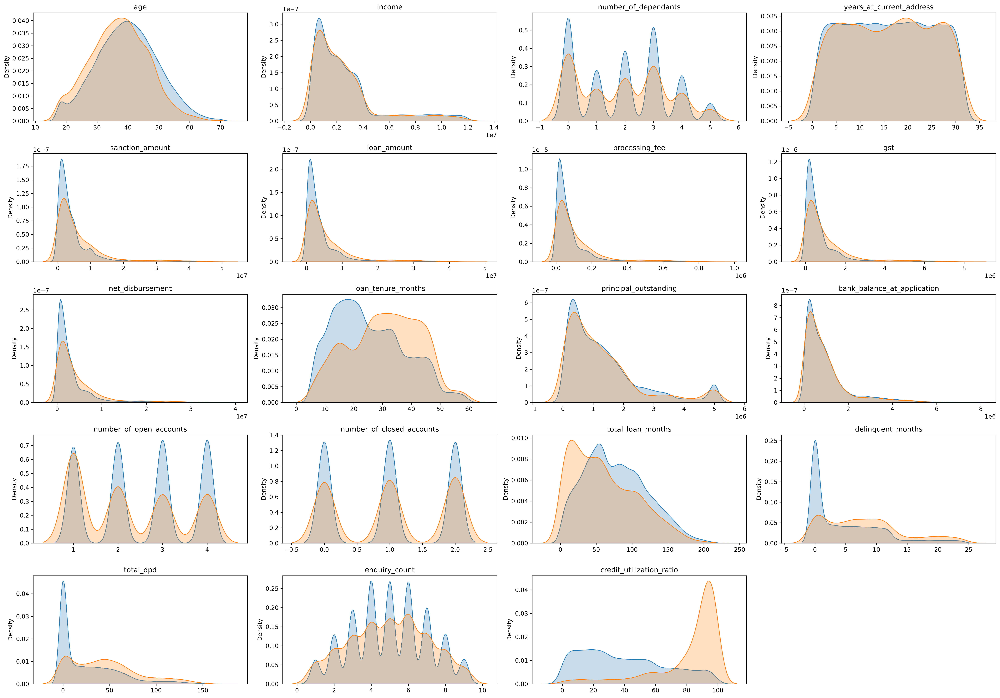
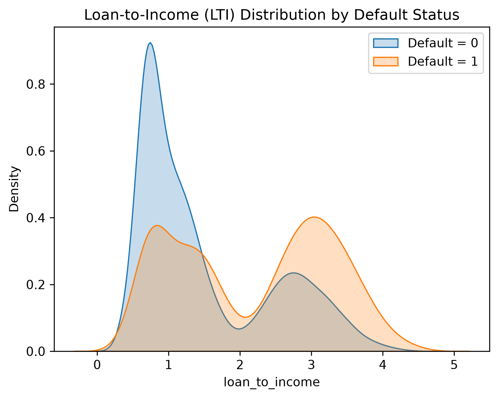
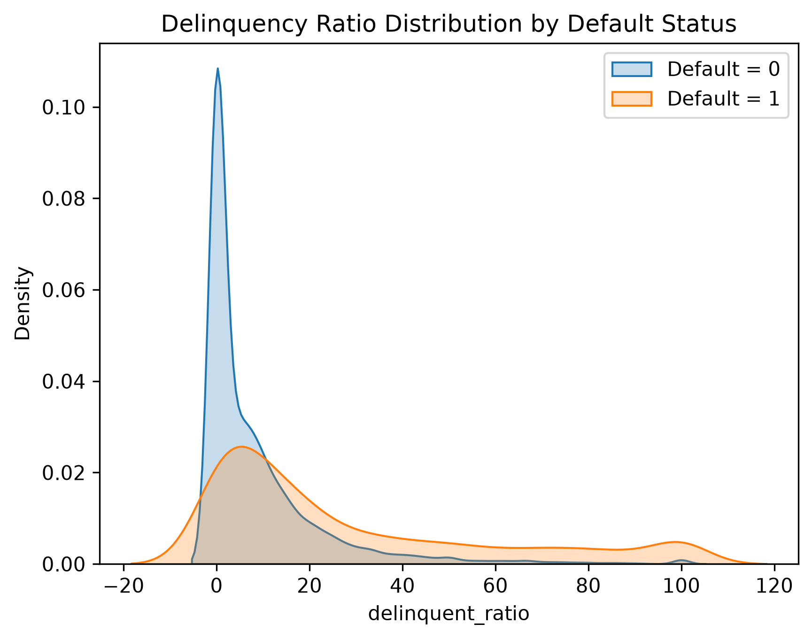
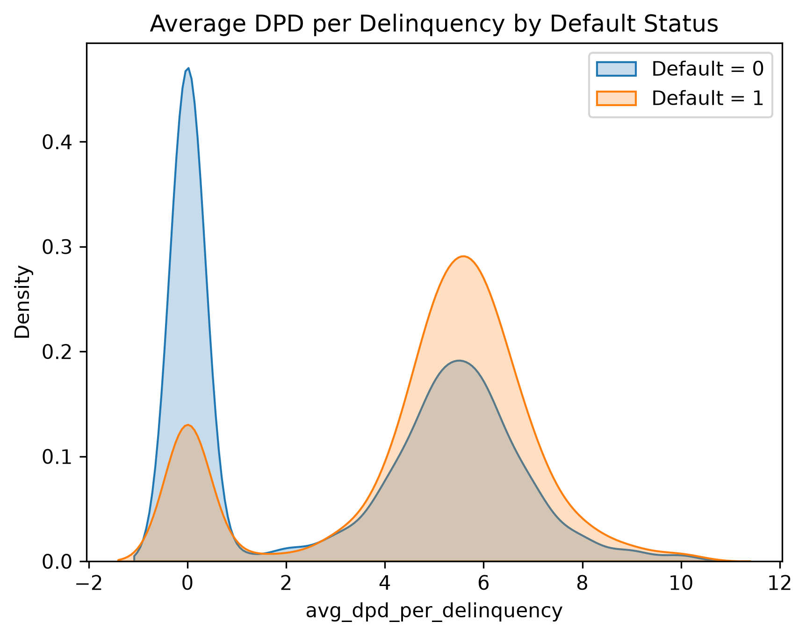
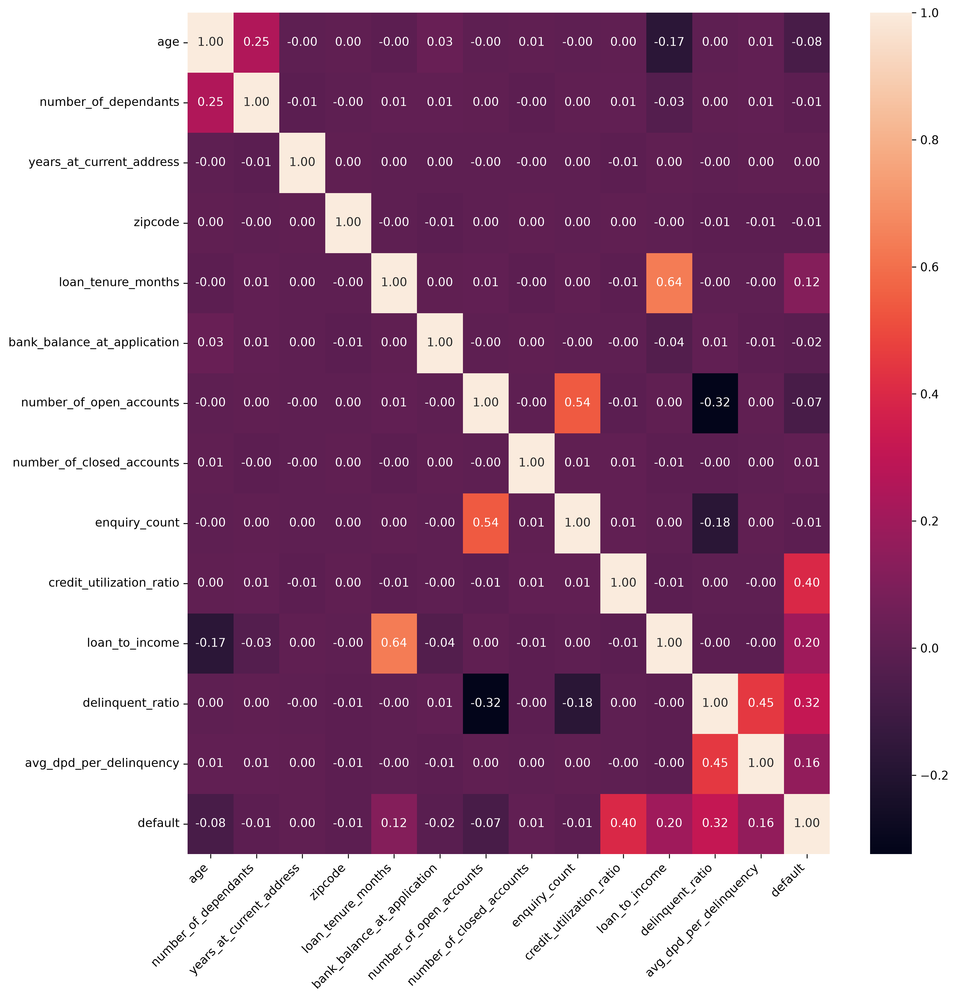
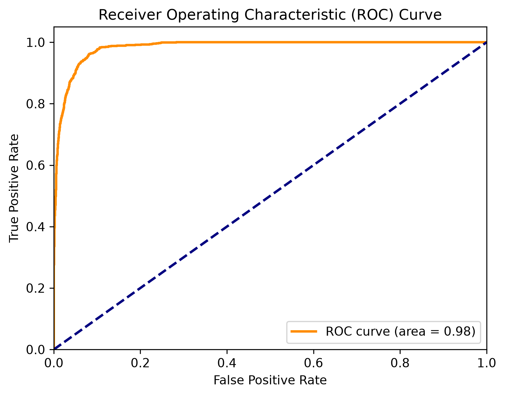
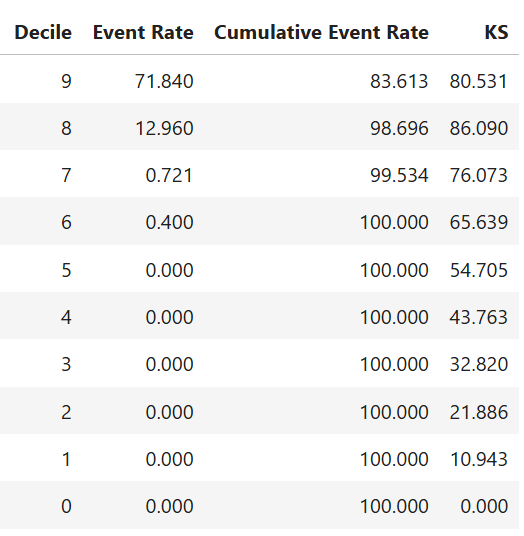
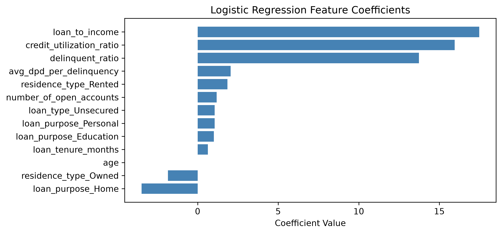

# Credit Risk Modeling

🔗 **Live App:** 
https://credit-risk-modeling-by-arifbhatti.streamlit.app/

---

## Project Overview

This project focuses on building a machine learning classification model to assess the credit risk of loan applicants and predict the likelihood of loan default.

The project combines customer, loan, and credit bureau data to identify factors associated with default risk and develop a model that can help financial institutions make more informed lending decisions.

The workflow covers data cleaning, exploratory data analysis, feature engineering, feature selection, class imbalance handling, model training, hyperparameter tuning, and model evaluation using credit-risk-focused metrics such as AUC, Gini coefficient, and KS statistic.

## Business Problem

The objective of this project is to help a financial institution assess the credit risk of loan applicants before approving a loan.

The model predicts whether a customer is likely to **default on a loan** based on customer information, loan characteristics, and credit history. Since default cases represent a smaller portion of the dataset, handling class imbalance and prioritizing the identification of potential defaulters are important parts of the modeling process.

## Dataset

The project uses three datasets containing customer, loan, and credit bureau information:

- **Customer Data:** Customer demographics, employment, income, residence, and location details.
- **Loan Data:** Loan characteristics, financial details, tenure, and default status.
- **Bureau Data:** Credit history and repayment-related information.

Each dataset contains **50,000 records**. The datasets are merged to create a single dataset for credit risk analysis and modeling.

## Exploratory Data Analysis

The analysis highlighted several variables with a noticeable relationship with loan default. Higher values of `loan_tenure_months`, `delinquent_months`, `total_dpd`, and `credit_utilization_ratio` were more common among defaulting customers.

`loan_amount` and `income`, however, did not show a clear pattern individually. This led to combining them into a `loan_to_income` (LTI) ratio, which was explored further as an engineered risk feature.

## Feature Engineering

To capture relationships that were not clear from individual variables, three new features were created:

- `loan_to_income` — loan amount relative to customer income.
- `delinquent_ratio` — proportion of loan tenure spent in delinquency.
- `avg_dpd_per_delinquency` — average days past due for each delinquent month.

### Loan-to-Income Ratio

`loan_to_income` was created to measure the loan amount relative to the customer's income.

The distribution shows that defaulted customers are more concentrated at higher LTI values, suggesting that a larger loan relative to income is associated with higher default risk.

### Delinquency Ratio

The `delinquent_ratio` measures the proportion of the loan tenure during which a customer was delinquent.

Defaulted customers are more concentrated at higher delinquency ratios, indicating that a greater proportion of delinquent loan months is associated with higher default risk.

### Average DPD per Delinquency

The `avg_dpd_per_delinquency` feature captures the average number of days a customer remained past due during delinquent months.

Defaulted customers are more common at higher values, suggesting that longer delays in repayment are associated with higher default risk.

## Feature Selection

Multicollinearity was assessed using Variance Inflation Factor (VIF), and highly correlated features were removed to reduce redundancy.

Weight of Evidence (WOE) and Information Value (IV) were then used to evaluate the relationship between the remaining features and loan default. Features with an IV greater than `0.02` were retained for modeling.

The selected features were encoded using one-hot encoding, with one category dropped from each categorical feature to avoid redundancy.

## Model Training & Evaluation

Several classification approaches were tested to improve the identification of customers likely to default.

The initial models included Logistic Regression, Random Forest, and XGBoost. Hyperparameter tuning was then applied to improve their performance.

Because the dataset is imbalanced, different resampling techniques were also evaluated. Random Under-Sampling produced very high recall but lower precision, while SMOTETomek provided a better balance between identifying defaults and limiting false positives.

The final model was a tuned **Logistic Regression** model trained on the SMOTETomek-balanced training data.

### Model Performance

On the test set, the model achieved:

- **Precision:** 56%
- **Recall:** 94%
- **F1-score:** 70%

The model's high recall means it identified a large proportion of the actual default cases.

### ROC-AUC

The model achieved an **AUC of 0.98**, indicating strong discrimination between default and non-default customers.

The corresponding **Gini coefficient is 0.96**, calculated as `Gini = 2 × AUC - 1`.

## Rank Ordering & KS Analysis

The model's predicted probabilities were divided into deciles to assess whether customers with higher predicted risk were concentrated among actual default cases.

The highest-risk decile had an event rate of **71.84%**, while the next decile had an event rate of **12.96%**. The cumulative event rate reached **100% by Decile 6**, and the maximum KS value was **86.09% at Decile 8**, indicating strong separation between default and non-default customers.

## Model Interpretation

The model coefficients were examined to understand the contribution of each selected feature to predicted default risk.

`loan_to_income`, `credit_utilization_ratio`, and `delinquent_ratio` had the strongest positive coefficients, indicating their association with higher predicted default risk.

## Streamlit Application

The trained model was deployed as a Streamlit application for assessing the likelihood of loan default.

The application allows users to enter customer and loan details and generates a predicted default probability.

## Technologies Used

- Python
- Pandas
- NumPy
- Scikit-learn
- XGBoost
- Imbalanced-learn
- Optuna
- Matplotlib
- Seaborn
- Streamlit
- Jupyter Notebook

---

## Author

**Muhammad Arif Bhatti**

- GitHub: https://github.com/arifbhatti-py
- LinkedIn: https://linkedin.com/in/arifbhatti

